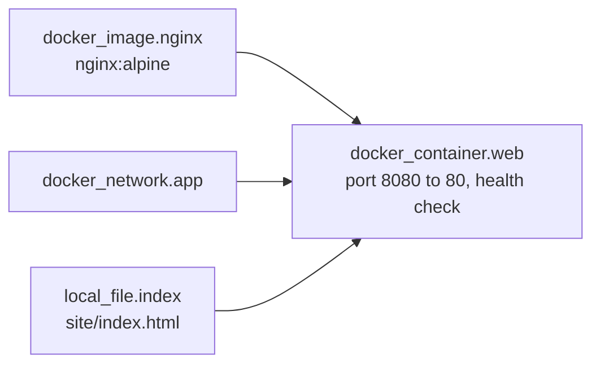
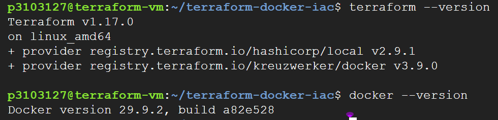
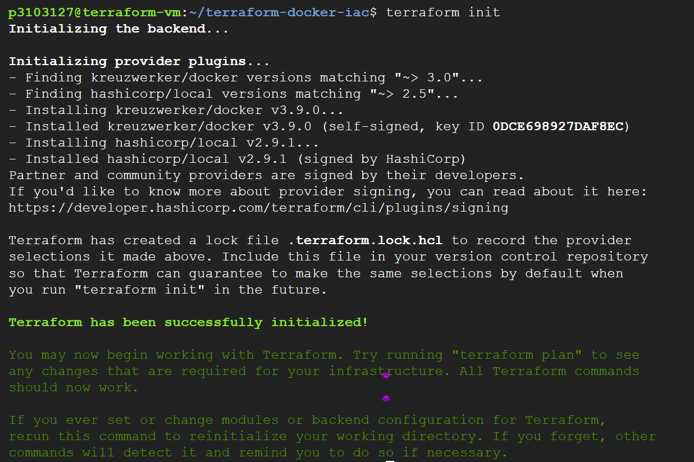
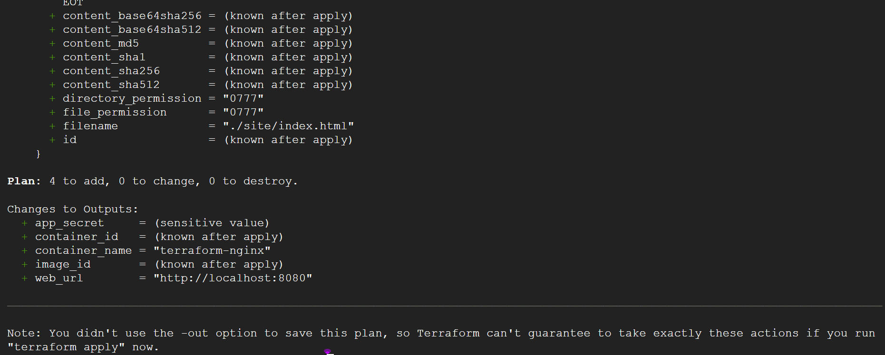
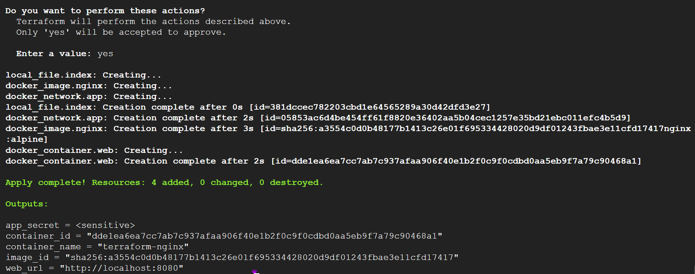
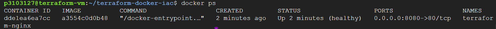
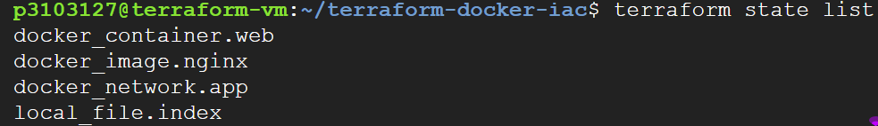
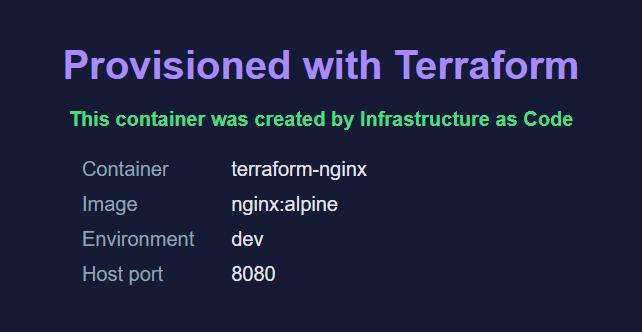
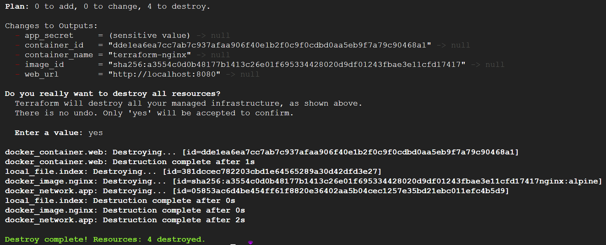

# terraform-docker-iac

**Infrastructure as Code with Terraform:** provision a local **Docker container** (nginx) using the
Terraform **Docker provider**, including image, network, generated web page, health check and
resource limits. The whole workflow (`init`, `plan`, `apply`, `state`, `destroy`) is automated by one script
that saves **every execution log** in the [`logs/`](logs) folder.

> DevOps Internship - Task 3: Infrastructure as Code (IaC) with Terraform

## What this project shows

| Hint of the task | Where / how it is done |
|---|---|
| a. Use the Docker provider | `main.tf`: `kreuzwerker/docker` provider, pinned to `~> 3.0` |
| b. Write Terraform code to create a container | `main.tf`: `docker_image`, `docker_network`, `local_file`, `docker_container` |
| c. Run `terraform init` and `apply` | `logs/01-init.log`, `logs/05-apply.log` |
| d. Destroy the infrastructure | `logs/12-destroy.log`, `logs/13-after-destroy.log` |
| e. Use `terraform plan` before `apply` | `logs/04-plan.log` (saved plan `tfplan` is applied), `logs/10-plan-again.log` shows *No changes* |
| f. Check the `terraform state` commands | `logs/06-state-list.log`, `logs/07-state-show.log` |

## Architecture



Terraform builds this dependency graph from the references in `main.tf`
(for example `image = docker_image.nginx.image_id`). It creates the three independent resources first,
then the container, and destroys everything in the reverse order.

## Files

```
terraform-docker-iac/
├── main.tf                    # provider and resources (the main deliverable)
├── variables.tf               # input variables with validation (one is sensitive)
├── outputs.tf                 # container name, id, image id, URL, sensitive output
├── terraform.tfvars.example   # example values (copy to terraform.tfvars)
├── run.sh                     # runs the full workflow and writes the execution logs
├── .terraform.lock.hcl        # exact provider versions (created by terraform init, commit it)
├── .gitignore                 # keeps state files, secrets and downloaded providers out of Git
├── logs/                      # execution logs of every step
└── docs/
    ├── INTERVIEW_QA.md        # answers to the interview questions of the task
    └── screenshots/           # evidence
```

## Prerequisites

- Docker Engine (the user must be able to run `docker ps` without `sudo`)
- Terraform 1.5 or newer
- Internet access (to download the provider and the nginx image)

## How to run

### Option 1: everything with one command (creates all logs)

```bash
bash run.sh
```

The script stops when the infrastructure is running so that you can take screenshots
(`docker ps`, the browser at `http://localhost:8080`). Press Enter to continue with `terraform destroy`.
Use `bash run.sh --no-pause` to run without stopping.

### Option 2: the commands one by one

```bash
terraform init        # download the Docker and local providers
terraform fmt         # format the code
terraform validate    # check the syntax
terraform plan        # preview the changes (nothing is created yet)
terraform apply       # create the container (asks for "yes")
terraform state list  # resources that Terraform manages
terraform state show docker_container.web
terraform output
docker ps
curl http://localhost:8080
terraform destroy     # remove everything (asks for "yes")
```

## Result

After `terraform apply` four resources exist:

```
docker_container.web
docker_image.nginx
docker_network.app
local_file.index
```

`docker ps` shows the container `terraform-nginx` as **healthy** with `0.0.0.0:8080->80/tcp`, and
`http://localhost:8080` shows the page generated by Terraform. After `terraform destroy` the container and
the network are gone and the state is empty (the nginx image is kept locally because of `keep_locally = true`).

## Variables

| Variable | Default | Description |
|---|---|---|
| `docker_host` | `unix:///var/run/docker.sock` | Docker daemon address (Windows Docker Desktop: `npipe:////./pipe/docker_engine`) |
| `image_name` | `nginx:alpine` | Image to pull and run |
| `container_name` | `terraform-nginx` | Container name |
| `external_port` | `8080` | Host port (validated: 1024-65535) |
| `environment` | `dev` | `dev`, `staging` or `prod` (validated) |
| `memory_mb` | `128` | Memory limit of the container |
| `app_secret` | dummy demo value | **Sensitive** variable passed to the container |

Change a value without editing the code, for example:

```bash
terraform apply -var="external_port=9090" -var="environment=staging"
```

## Security notes (secrets)

- `app_secret` is declared with `sensitive = true`, so Terraform shows `(sensitive value)` in plans and
  `<sensitive>` in outputs instead of the value.
- The default value in this repository is a **dummy** value for the demo only. For a real secret use
  `export TF_VAR_app_secret="..."` or a `terraform.tfvars` file, which is git-ignored. Never hard-code secrets.
- **Important:** Terraform still stores values in the **state file in plain text**. That is why `*.tfstate` is in
  `.gitignore`, and why real projects use an encrypted remote backend (for example a locked cloud storage bucket) or a
  secret manager such as HashiCorp Vault.

## Evidence (screenshots)

| Step | Screenshot |
|---|---|
| Tool versions |  |
| `terraform init` |  |
| `terraform plan` |  |
| `terraform apply` complete |  |
| `docker ps` (container healthy) |  |
| `terraform state` commands |  |
| Web page in the browser |  |
| `terraform destroy` complete |  |

## Interview questions

Short answers are in [docs/INTERVIEW_QA.md](docs/INTERVIEW_QA.md).
